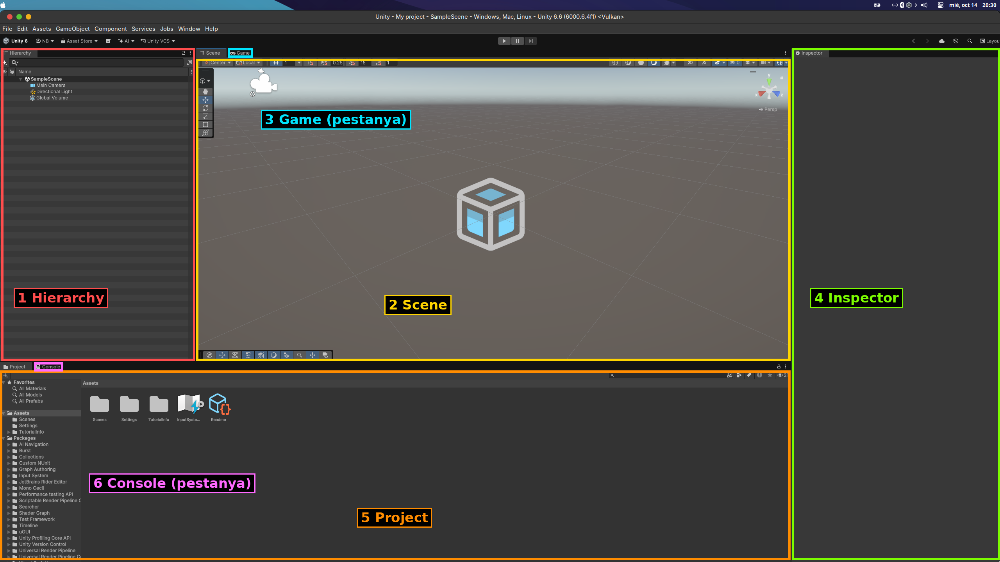

# T1.1 Glossari de termes (b)
## GameObject

Un **GameObject** és qualsevol objecte que podem afegir a una escena d'Unity, com ara un cub, una esfera o una llum.

Equivalent anglès: **GameObject**.

## Transform

El **Transform** serveix per controlar on està situat un objecte, com gira i quina mida té.

Equivalent anglès: **Transform**.

## Scene

Una **Scene** és l'espai on col·loquem i organitzem els diferents elements del nostre joc.

Equivalent anglès: **Scene**.

## Hierarchy

La finestra **Hierarchy** ensenya la llista d'objectes que tenim dins de l'escena oberta.

Equivalent anglès: **Hierarchy**.

## Inspector

L'**Inspector** permet veure i canviar les característiques de l'objecte que tenim seleccionat.

Equivalent anglès: **Inspector**.

## Project

La finestra **Project** conté els arxius del projecte, com ara les escenes, els materials, les imatges i els scripts.

Equivalent anglès: **Project**.

## Material

Un **Material** serveix per canviar l'aspecte d'un objecte, per exemple, posant-li un color o una textura.

Equivalent anglès: **Material**.

## Prefab

Un **Prefab** és un objecte guardat com a plantilla que podem reutilitzar diverses vegades dins del joc.

Equivalent anglès: **Prefab**.

## Rigidbody

Un **Rigidbody** és un component que permet que un objecte es comporti segons les lleis de la física, com quan cau per la gravetat.

Equivalent anglès: **Rigidbody**.

## Collider

Un **Collider** és un component que permet detectar els contactes i les col·lisions entre objectes del joc.

Equivalent anglès: **Collider**.

# T1.2 Inventari de finestres (b)

Finestres numerades a la captura:

1. Jerarquia (Hierarchy): Mostra tots els objectes que formen part de l'escena, com la càmera i la llum.

2. Escena (Scene): Permet veure, crear i modificar visualment els elements de l'entorn 3D.

3. Joc (Game): Mostra com es veurà el joc des de la perspectiva de la càmera.

4. Inspector: Mostra les propietats de l'objecte seleccionat i permet modificar-les.

5. Projecte (Project): Mostra els fitxers i les carpetes que formen part del projecte.
 
6. Consola (Console): Mostra els missatges, els avisos i els errors que es produeixen durant el desenvolupament.

# T1.3 Escena amb un cub pintat (b)
[Escena cub pintat](Proyecto_natalia/Scenes/Casa_UF1_Natalia.unity)

# T1.4 Tres objectes amb física (m)
[Escena objectes fisica](Proyecto_natalia/Scenes/Tres_objectes_fisica_Natalia.unity)
**Per què no es mouen les esferes quan premo Play?** Perquè no tenen cap Rigidbody. La gravetat i les forces només afecten els objectes que tenen aquest component; el Collider tot sol fa que l'objecte sigui sòlid, però no el fa moure. No cal tocar Physics > Auto Simulation: el motiu és la falta de Rigidbody.

**I si afegeixo un Rigidbody a una esfera?** Aquesta esfera cau per la gravetat i es queda aturada sobre el Plane (gràcies al Collider del Plane), mentre les altres dues continuen suspeses a l'aire.

**I si l'afegeixo a les tres?** Cauen totes tres, cadascuna des de la seva alçada, i aterren sobre el Plane en moments diferents (les més baixes primer). Si una cau a sobre d'una altra, hi xoca.

# T1.5 Moneda que gira (m)
[Escena spinner](Proyecto_natalia/Scenes/MonedaGira_Natalia.unity)
[Script spinner](Proyecto_natalia/Scripts/Spinner.cs)

# T1.6 Material amb textura (m)
[Escena material amb textura](Proyecto_natalia/Scenes/MaterialTextura.unity)
[Textures ](Proyecto_natalia/Materials/Metal/)
[Material textures ](Proyecto_natalia/Materials/Material_importado.mat)

# T1.7 REPTE: Plataformes mòbils (r)
[Escena plane amb player moure](Proyecto_natalia/Scenes/Plataformes%20mòbils_Natalia.unity)
[Script moure només plane](Proyecto_natalia/Scripts/MoverPlane.cs)
[Script moure plane i jugador](Proyecto_natalia/Scripts/SolucioMoverPlaneyJugador.cs)

**Per què no és tan fàcil com sembla?** Perquè la plataforma es mou canviant directament el seu `transform.position`, no amb la física. L'esfera (amb Rigidbody) no rep cap força ni fricció de la plataforma, així que es queda al seu lloc i la plataforma llisca per sota seu fins que l'esfera cau.

**Com ho resoldria?** Fent que el Player sigui fill de la plataforma mentre hi està a sobre: a `SolucioMoverPlaneyJugador.cs`, amb `OnCollisionEnter` (i el tag `Plataforma`) faig `transform.SetParent(...)` i amb `OnCollisionExit` el torno a deixar sense pare. Així el Player es mou amb la plataforma. Limitació: si la plataforma té una escala no uniforme, el fill es deforma. Una altra opció seria moure la plataforma amb un Rigidbody cinemàtic i `MovePosition`, o sumar la velocitat de la plataforma al Player.

# T1.8 REPTE: Una escena amb 5 monedes i un script que les instanciï (r)
[Escena amb 5 monedes](Proyecto_natalia/Scenes/5monedes_Natalia.unity)
[Script coin](Proyecto_natalia/Scripts/CoinSpawner.cs)
